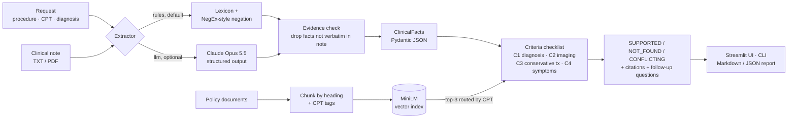

<div align="center">

# Clinova

**An evidence-grounded clinical intelligence and prior-authorization copilot**

Clinova reads a prior-authorization request and its clinical note. It pulls out clinical facts, each tied to the sentence it came from, and retrieves the matching policy sections. It then marks each criterion `SUPPORTED`, `NOT_FOUND`, or `CONFLICTING` for a human reviewer to decide on.

[](https://www.python.org/)
[](https://streamlit.io/)
[](https://docs.pydantic.dev/)
[](#deploy)
[](#data-provenance)

[Quickstart](#quickstart) · [How it works](#how-it-works) · [Evaluation](#evaluation) · [Deploy](#deploy) · [Design decisions](docs/MODEL_FLOW_AND_DECISIONS.md)

</div>

> [!IMPORTANT]
> **Decision-support output only; human review required.** All cases and policy text are synthetic or
> illustrative. Clinova never approves or denies a request and gives no medical advice. `NOT_FOUND` means
> *"not in the supplied documents"*, never *"criterion unmet"*.

## Highlights

- **Grounded extraction.** Every fact cites a sentence copied word for word from the note. A fact whose sentence isn't found word for word in the note is dropped, which guards the optional LLM against making things up.
- **Three-state checklist.** The only statuses are `SUPPORTED`, `NOT_FOUND` and `CONFLICTING`. `APPROVED` and `DENIED` can't be represented in the schema.
- **Local RAG.** Policies are split by heading, embedded with MiniLM and filtered by procedure (CPT) code. Filtering by code raised Hit@1 from 82% to 100%.
- **Optional Claude extractor.** Claude Opus 5.5 with structured outputs, for phrasing the rule lexicon misses.
- **Honest evaluation.** Dev and held-out splits, Wilson confidence intervals, and a retrieval ablation (the same eval run with retrieval features switched off).
- **Ready to deploy.** Docker image with CPU-only torch and the embedding model built in. The tests run during the build, the app runs as a non-root user, and a health check is included.

## Example output

`python -m src.pipeline PA-003`: a knee-replacement request where the radiology line and the clinic summary disagree.

| # | Criterion | Status | Explanation |
|---|---|---|---|
| C1 | Documentation of the relevant diagnosis | ✅ SUPPORTED | Note documents: osteoarthritis. |
| C2 | Documentation of imaging findings | ⚠️ CONFLICTING | Imaging severity differs between statements: 'mild joint space narrowing and no significant osteophytes' vs 'advanced, bone-on-bone osteoarthritis of the right knee'. |
| C3 | Documentation of conservative treatment and response | ✅ SUPPORTED | Note documents: NSAIDs, inadequate relief, physical therapy. |
| C4 | Documentation of persistent symptoms and clinical rationale | ✅ SUPPORTED | Note documents: chronic, functional limitation, pain. |

Each criterion in the full report lists the note sentences that support it and the top-3 policy passages, cited as `[document § section] (score)`. The report ends with follow-up questions for the provider.

## Quickstart

```bash
git clone https://github.com/A-b29/Clinova---An-Evidence-Grounded-Clinical-Intelligence-Prior-Authorization-Platform.git clinova
cd clinova
python -m venv .venv && source .venv/bin/activate      # Windows: .venv\Scripts\activate
pip install -r requirements.txt

streamlit run app.py                                   # UI at http://localhost:8501
python -m src.pipeline PA-001                          # CLI: Markdown report
python -m src.pipeline PA-003 --json                   # CLI: full Review JSON
python -m pytest                                       # 29 tests, ~5 s, offline
python -m eval.run_eval                                # metrics -> eval/results_rules.md
```

The first run downloads the `all-MiniLM-L6-v2` embedding model (~90 MB) from Hugging Face.

| Env var | Default | Effect |
|---|---|---|
| `EMBEDDING_BACKEND` | `minilm` | `minilm` (semantic) or `tfidf` (keyword-based, no model download). If MiniLM can't load, Clinova switches to TF-IDF automatically. |
| `ANTHROPIC_API_KEY` | unset | Turns on the `llm` extractor (Claude Opus 5.5) in the UI and the CLI (`--extractor llm`). |

## How it works



Only the LLM can invent things, and it's optional, limited to a fixed schema, and checked against the
source text. Every status the reviewer sees comes from a rule they can read and audit. The full
walkthrough and the 15 design decisions behind it are in
**[docs/MODEL_FLOW_AND_DECISIONS.md](docs/MODEL_FLOW_AND_DECISIONS.md)**.

<details>
<summary><b>Project structure</b></summary>

| Path | Responsibility |
|---|---|
| `src/schemas.py` | Pydantic contracts (`CaseRequest`, `Fact`, `ClinicalFacts`, `CriterionResult`, `Review`) |
| `src/ingestion.py` | TXT/MD/PDF loading, heading-based policy chunking, procedure-code tags |
| `src/extraction.py` | Rule extractor (lexicon + NegEx-style negation), Claude extractor, verbatim-evidence check |
| `src/retrieval.py` | MiniLM / TF-IDF embeddings, in-memory cosine index, procedure-code routing |
| `src/assessment.py` | The four criteria, status rules, conflict detection, follow-up questions |
| `src/reporting.py` | Deterministic Markdown report |
| `src/pipeline.py` | End-to-end `review_case()` and the CLI |
| `app.py` | Streamlit UI (sample cases or upload a TXT/PDF note) |
| `eval/` | Hand-labelled expectations (`evaluation_cases.json`) and `run_eval.py` |
| `tests/` | pytest suite (schemas, extraction, retrieval, assessment) |
| `data/cases/` | 7 synthetic cases (5 dev + 2 held-out) |
| `data/policies/` | 5 illustrative policy documents (TKA, THA, knee arthroscopy, lumbar MRI, general) |

</details>

## Evaluation

7 synthetic cases and 28 criterion decisions. Configuration: rules extractor, MiniLM, CPT routing. Full output: [`eval/results_rules.md`](eval/results_rules.md).

| Metric | Dev (5 cases) | Held-out (2 cases) |
|---|---|---|
| Fact extraction precision / recall / F1 | 1.00 / 1.00 / 1.00 | 1.00 / 0.77 / 0.87 |
| Checklist status accuracy | 20/20 | 7/8 |
| Schema validity | 7/7 overall | |
| Evidence grounding (cited sentence found verbatim in the note, policy passage attached) | 28/28 overall | |
| Retrieval Hit@1 / MRR@3 | 100% / 1.00 (8 distinct queries) | |
| Failed runs | 0/7 | |
| Latency | ~40 ms per case after a one-off model load (~20 s cold) | |

> [!NOTE]
> **This is a smoke test, not validation.** I wrote the rule lexicon while looking at the dev notes, so
> the dev scores are in-sample. The held-out cases show the real weakness. The rules don't know that
> "formal rehab" means physical therapy or that "anti-inflammatories" means NSAIDs, so PA-006's
> conservative-treatment criterion comes out `NOT_FOUND` instead of `SUPPORTED`. Even at 20/20, the 95%
> Wilson lower bound on accuracy is only about 84%.

## Deploy

### Docker (any container host)

```bash
docker build -t clinova .
docker run -p 8501:8501 clinova                                # rules extractor
docker run -p 8501:8501 -e ANTHROPIC_API_KEY=... clinova       # + Claude extractor
```

The image installs CPU-only torch, which skips the multi-GB CUDA wheels: it is about 670 MB compressed and about 2 GB unpacked. It includes the embedding model and sets `HF_HUB_OFFLINE=1`, so it never calls Hugging Face at runtime. The test suite runs during the build, so a broken commit can't produce an image. The app runs as a non-root user, and a `HEALTHCHECK` polls Streamlit's `/_stcore/health`.

The image runs unchanged on Google Cloud Run, AWS App Runner / ECS, Azure Container Apps, or Hugging Face Spaces (Docker SDK). Pass `ANTHROPIC_API_KEY` in from the platform's secret manager; never build it into the image.

### Streamlit Community Cloud

Point Streamlit Community Cloud at this repo and set `app.py` as the entry file. To use the LLM extractor, add `ANTHROPIC_API_KEY` under *Secrets*. If memory is tight, set `EMBEDDING_BACKEND=tfidf`. With CPT routing on, TF-IDF scored the same as MiniLM on this eval set.

## Data provenance

I wrote all cases and policies by hand for this project. No real patients, providers or payer policies are involved. Each note begins with `SYNTHETIC CLINICAL NOTE - FICTIONAL PATIENT`, and each policy carries an `ILLUSTRATIVE SAMPLE TEXT` banner. The CPT and ICD-10 codes are real public codes, used only as routing metadata.

| Case | Procedure | Designed to test | Split |
|---|---|---|---|
| PA-001 | Total knee arthroplasty | Complete documentation (happy path) | dev |
| PA-002 | Total knee arthroplasty | Missing imaging and conservative treatment → `NOT_FOUND` | dev |
| PA-003 | Total knee arthroplasty | Mild vs advanced imaging in two places → `CONFLICTING` | dev |
| PA-004 | Total hip arthroplasty | Complete documentation, different policy | dev |
| PA-005 | Total hip arthroplasty | Request/note diagnosis mismatch; PT both done and declined | dev |
| PA-006 | Total knee arthroplasty | Clinical shorthand ("DJD", "formal rehab", "anti-inflammatories") | held-out |
| PA-007 | Total knee arthroplasty | Explicit negations ("denies PT", "no imaging on file") | held-out |

## Limitations

- **Lexicon coverage.** The rule extractor only finds terms in its lexicon. The Claude extractor is there to handle varied phrasing, but it hasn't been scored against the gold labels yet. To score it, set a key and run `python -m eval.run_eval --extractor llm`.
- **Negation.** Negation detection is a NegEx-style heuristic: it looks 5 words back and 4 words ahead, and masks phrases like "no increase" that look negative but aren't. It doesn't handle long-range or double negation.
- **Imaging severity.** Conflicts in imaging severity are detected by keyword. Two compartments of different severity, described in separate sentences, are flagged `CONFLICTING`. That's a deliberate bias towards asking a human to look.
- **Not checked.** Laterality (left vs right), dates and recency.
- **Small retrieval eval.** Retrieval queries come only from the procedure and the criterion, so the retrieval eval has just 8 distinct queries.
- **No production controls.** There's no authentication, audit log or PHI (protected health information) control. **Don't upload real patient data**, especially with the LLM extractor turned on.

The production roadmap is in [docs/MODEL_FLOW_AND_DECISIONS.md](docs/MODEL_FLOW_AND_DECISIONS.md).

<details>
<summary><b>5-minute demo script</b></summary>

1. `streamlit run app.py` and read the safety banner out loud.
2. **PA-001** (happy path): four green tiles. Open *Extracted facts*: every row has an evidence sentence copied word for word from the note. Open *Criteria checklist*: each criterion cites the TKA policy section it maps to.
3. **PA-002** (missing documents): imaging and conservative treatment come out `NOT_FOUND`. Point out the wording *"does not establish that the criterion is unmet"* and the generated questions for the provider.
4. **PA-003** (conflict): C2 is `CONFLICTING` because the radiology line says *mild* and the clinic summary says *advanced, bone-on-bone*. That's exactly what a reviewer needs to see.
5. **PA-005**: the diagnosis doesn't match (the request says osteoarthritis, the note says avascular necrosis), and PT was both "tried" and "declined".
6. Open the *Review report* tab and download the Markdown/JSON.
7. Close with the eval table and the held-out miss on PA-006, and explain why it motivates the LLM extractor and a larger labelled set.

</details>
